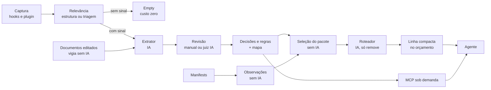

# Visão do fluxo: da conversa ao contexto do agente

Mapa de uma página do caminho que uma conversa percorre até voltar ao agente como contexto.
Cada etapa diz o que faz, se usa IA (custo), onde está o código, onde está a regra e o
número que a mede. O detalhe fica no documento citado; em caso de divergência, vale ele
(e o código acima de todos, ver [precedência](../README.md#precedência)).

## Etapas

| Etapa | O que faz | IA | Código | Regra | Medida |
| --- | --- | --- | --- | --- | --- |
| Captura | O `hook stop` do Claude Code e o plugin do OpenCode mandam o turno à API local; com o app fechado, à outbox. Segredos mascarados no adapter e no motor. | não | `apps/mcp-server/src/hook/`, `crates/application/src/captures.rs` | [contexto-e-agentes](contexto-e-agentes.md#hooks-do-claude-code) | dogfood: capturas, perdas |
| Relevância e triagem do turno | Estrutura (DDL, segurança, dependência, ADR/spec/`AGENTS.md`/`CLAUDE.md` editado, resposta a AskUserQuestion, documento) manda a captura ao extrator. Fala do usuário sem estrutura vai a uma triagem mínima de IA (`{decision, kind}`); só um sim chega ao extrator. Mensagens do harness não contam como fala. O resto termina `Empty`. | só na triagem | `crates/application/src/extract/relevance.rs` (`assess_relevance`) e `extract/triage.rs` | [qualidade-do-nucleo](qualidade-do-nucleo.md#relevância-estrutura-e-triagem-do-turno) | portões `relevance filter` e `turn triage`; replay; `turn_triages` |
| Extrator | Lê a captura e propõe candidatos (decisão ou regra) com evidência literal, relevância, ressalvas (qualificadores) e componentes do mapa. | sim | `crates/application/src/extract/`, job `analyze_capture` | [ADR-0006](adr/0006-tipo-e-relevancia-dos-candidatos.md), [ADR-0010](adr/0010-qualificadores-e-fronteira-de-envio.md) | dogfood: candidatos, latência |
| Revisão | Manual (padrão) ou automática: regras locais tiram repetições e um juiz de IA decide o resto em lote; o duvidoso volta para a pessoa. | só no automático | `crates/application/src/auto_approval.rs` | [ADR-0012](adr/0012-modo-automatico-e-autoridade.md) | portão `automatic review`; dogfood: confirmados, ruído, desfeitos |
| Decisões, regras e mapa | O confirmado vira decisão versionada ou regra (claim); vínculos com componentes nascem de menção afirmativa e de sinais do repositório. | em lote, para vínculos, relações, regras e termos | `crates/application/src/graph/`, `claims` | [ADR-0014](adr/0014-regras-com-escopo-por-componente.md), [ADR-0016](adr/0016-vinculos-por-estrutura-e-mencao-afirmativa.md) | portões de vínculos |
| Observações | Fatos descritivos dos manifests (`Cargo.toml`, `package.json`); nunca viram regra nem entram na revisão. O reconciliador relê só quando tamanho ou data de um manifest mudou. | não | `crates/application/src/observations/` (`refresh.rs`, `reconcile.rs`) | [ADR-0011](adr/0011-observacoes-descritivas-de-manifests.md) | portão `observation reconcile` (0 jobs parado) |
| Documentos | O vigia olha, a cada 60 s e sem abrir arquivo, o tamanho e a data dos documentos de cada projeto já indexado; mudou, espera uma volta (cinco edições seguidas do mesmo ADR custam 1 job), relê a pasta e enfileira só os documentos que mudaram. Pasta de arquivo (`archive-*`, `arquivados`) nunca entra; só roda com o provedor ligado. | só no `analyze_document` | `crates/application/src/documents/watch.rs` (`DocumentWatch`), `Documents::refresh_changed`; laço em `ObservationReconciler::spawn` | [qualidade-do-nucleo](qualidade-do-nucleo.md) | portão `document watch` (0 jobs parado) |
| Seleção do pacote | A cada pedido, escolhe decisões e regras que tocam a tarefa: texto, arquivos citados, componentes do mapa e regras globais (`*`). Busca FTS5 + grafo, sem embeddings. | não | `crates/application/src/context.rs` (`build_pack`) | [ADR-0013](adr/0013-contexto-sem-embeddings.md), [contexto-e-agentes](contexto-e-agentes.md#context-pack) | portões de seleção de contexto |
| Roteador | Para itens de casamento ambíguo, um juiz de IA em segundo plano marca relevante, irrelevante ou abstém; o resultado vale do pedido seguinte em diante e só pode **tirar** item duvidoso. Toda falha grava um código. | sim | `crates/application/src/context_routing.rs` | [ADR-0011](adr/0011-observacoes-descritivas-de-manifests.md) | Diagnóstico: `routing.failed` por código |
| Linha compacta | Cada item vira uma linha `D:`/`regra:` com escopo e qualificadores em texto, dentro do orçamento (300 tokens por padrão); o que não cabe é contado em "Omitidos". Prompts do harness não recebem bloco. | não | `crates/application/src/injection.rs` (`render_session_compact`, `knowledge_suffix`) | [contexto-e-agentes](contexto-e-agentes.md#injeção-no-pedido) | portão `context injection` e `compact_density_gate`; dogfood: injeções, tokens, omitidos |
| MCP | O agente pede mais quando precisa: `get_decision` (motivo e qualificadores completos, com artefato), `search_context`, `file_context`. | não | `crates/application/src/agent_access.rs`, `apps/mcp-server/` | [contexto-e-agentes](contexto-e-agentes.md#mcp-somente-leitura) | dogfood: MCP, MCP respondidas |

## Onde a IA custa

Cinco etapas chamam o provedor: a triagem do turno (uma chamada pequena, até 2.800 caracteres, só
para fala sem estrutura), o extrator, o juiz da revisão automática, sugestões em lote depois de
uma adoção e o roteador. Todas rodam em segundo plano, nunca no caminho do pedido do agente. O que
corta custo: a estrutura decide sem IA e a triagem evita o extrator inteiro em turnos rotineiros;
além disso, os lotes de até 10 decisões e o roteador só ver itens ambíguos. No replay sobre o
banco real, 68 de 116 capturas (07 a 18/10) iriam à triagem, ≈ 21,3 mil tokens de entrada no total.

## Como ler o dogfood

`python tools/dogfood-report.py` dá a tabela diária ([dogfood-log](../operacao/dogfood-log.md)).
Um sintoma aponta para a etapa:

- Muitas capturas e poucos candidatos: relevância e triagem (`turn_triages`: chamadas, `passed`, `error_code`).
- Ruído alto ou muitos desfeitos: extrator ou juiz da revisão.
- Muitos omitidos por injeção: linha compacta e orçamento.
- MCP em zero: o agente não pede mais contexto; a injeção é o único canal.
- Perdas: jobs e análises que falharam, com o motivo no Diagnóstico.

Para medir a seleção sobre os dados reais, com casos rotulados fora do repositório, use o
teste ignorado `crates/storage-sqlite/tests/dogfood_context.rs` (instruções no cabeçalho).
